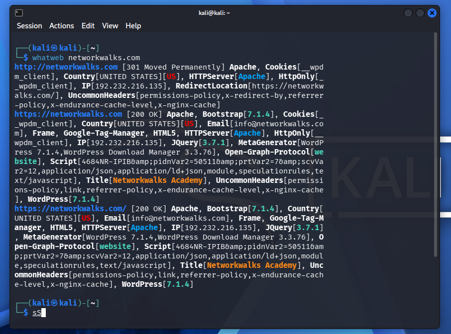
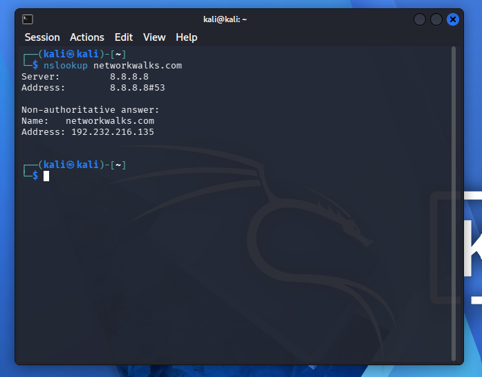
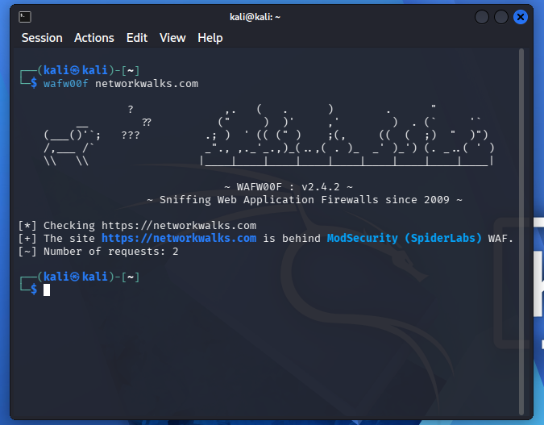
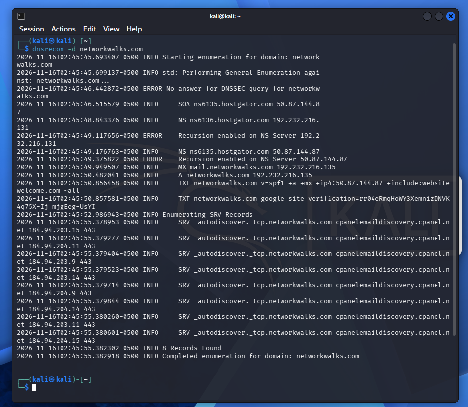
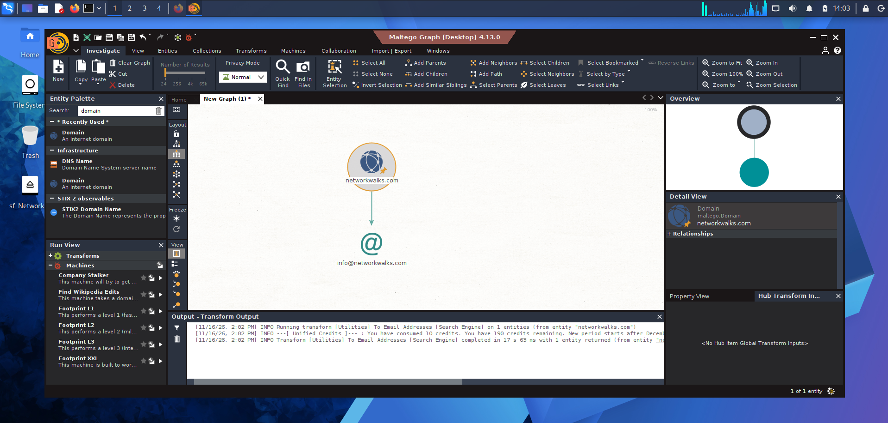
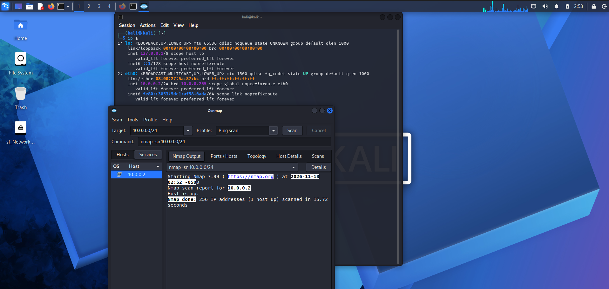
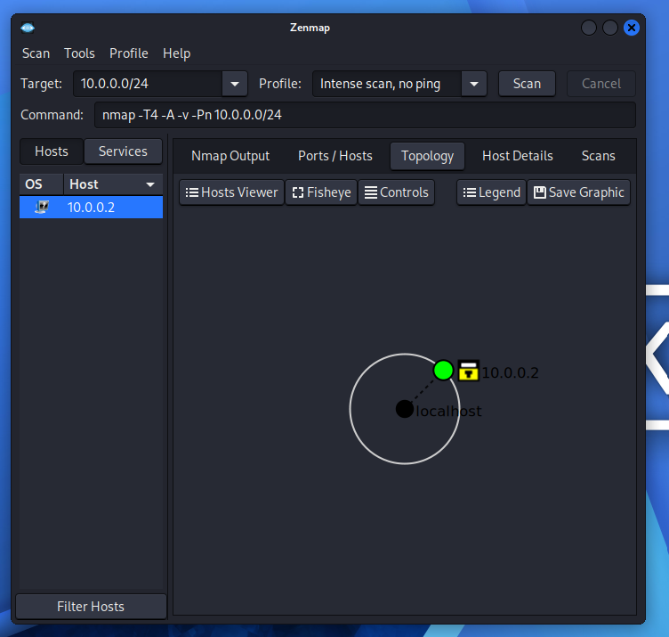

# NETWORKWALKS-LEHLOHONOLO-B084A-WK2-PM-FINAL-PENETRATION-TESTING-REPORT
NetworkWalks Week 2 footprinting and Zenmap host discovery report

# 🕵️‍♂️ Footprinting & Network Scanning Phases

**Week 2 Project | Cybersecurity Internship Program - Networkwalks (Batch B082)**

* * *

## 📌 Project Overview

This repository contains the documentation and evidence for Week 2 of my Cybersecurity Internship. This week focused on Phase 1 (Reconnaissance & Footprinting) and Phase 2 (Scanning & Network Discovery). 

The goal was to gather as much public information as possible about a target domain (`networkwalks.com`) using multiple Kali Linux tools, OSINT platforms, Finally, I performed active network scanning on my local virtual lab to discover live hosts.

**⚠️ Disclaimer:** All activities were performed strictly within the authorized scope defined by the Networkwalks Letter of Authorization (LOA) and on my own local virtual lab network. 

* * *

## 🛠️ Tools Used

| Tool | Purpose |
| :--- | :--- |
| **Kali Linux** | Operating system for terminal-based reconnaissance. |
| **WHOIS, WhatWeb, Nslookup, Curl, Wafw00f, DNSRecon** | The 6 essential Kali tools used for domain profiling. |
| **Maltego** | Used for visual data mining and link analysis. |
| **theHarvester** | Used to gather public emails and subdomains (OSINT). |
| **Zenmap (Nmap GUI)** | Scan the local subnet to find live hosts and map topology. |

* * *

## 🔍 Activities Performed

### 1. Kali Tools & Domain Reconnaissance (W2-PM1)
I performed reconnaissance against `networkwalks.com` using six Kali Linux tools:
*   **WHOIS:** Revealed the domain is hosted by HostGator.
*   **WhatWeb:** Fingerprinted the site, revealing it runs on WordPress 7.1.4 and uses the WP Download Manager plugin.
*   **Nslookup:** Resolved the domain to `192.232.216.135`.
*   **Curl -I:** Revealed the WordPress REST API (`/wp-json/`) in the HTTP headers.
*   **Wafw00f:** Detected a ModSecurity (SpiderLabs) Web Application Firewall.
*   **DNSRecon:** Enumerated DNS records, finding mail servers and confirming DNSSEC is disabled.

### 2. Maltego (W2-PM3)
I used Maltego to visually map the infrastructure of `networkwalks.com`. Starting with the domain name as a "seed," I ran the "DNS from Domain" and "MX Record" transforms. This created a visual graph showing the relationship between the domain, its IP address (`192.232.216.135`), and its mail servers. 

### 3. theHarvester (W2-PM4)
I used theHarvester to gather Open-Source Intelligence (OSINT) about the target. 
*   **Command:** `theHarvester -d networkwalks.com -b all -l 1000`
*   **Finding:** This gathered public email addresses (e.g., `info@networkwalks.com`) and identified subdomains. Attackers use these emails for phishing campaigns and the subdomains to find weaker, overlooked servers.

### 4. Network Scanning with Zenmap (W2-PM5)
I used Zenmap to perform network discovery on my local virtual lab network (`10.0.0.0/24`). I used the **Ping Scan** to identify active hosts. The scan successfully identified the VirtualBox Gateway (`10.0.0.1`) and my Kali Linux VM (`10.0.0.2`). I then generated a visual network topology map.

* * *

## 🚨 Risk Analysis / Impact

| # | Risk / Finding | Evidence / Observation | Potential Impact | Risk Level |
| :--- | :--- | :--- | :--- | :--- |
| 1 | **Web Tech Exposed** | WhatWeb identified WordPress 7.1.4 and WP Download Manager. | Attackers can search for known exploits matching these specific versions. | Medium |
| 2 | **Server IP Identifiable** | Nslookup resolved the domain to `192.232.216.135`. | Provides information about the network location of the web service. | Low |
| 3 | **HTTP Info Exposed** | Curl returned HTTP headers exposing `/wp-json/`. | May assist technology fingerprinting and further enumeration. | Low |
| 4 | **WAF Identifiable** | Wafw00f identified ModSecurity (SpiderLabs). | Reveals the web application's security architecture. | Low |
| 5 | **DNS Info Exposed** | DNSRecon identified DNS and mail records; DNSSEC disabled. | Susceptible to DNS spoofing and helps build an infrastructure profile. | Medium |
| 6 | **Exposed IoT Devices** | GHDB dorks found live webcams with no authentication. | Complete loss of privacy for the owner; cameras can be used as a botnet. | High |
| 7 | **Open Directory Listings** | GHDB dorks found open folders containing PDFs. | Intellectual property theft or exposure of internal documents. | Medium |
| 8 | **Email Addresses Harvested** | theHarvester found public emails associated with the domain. | High risk of targeted phishing (social engineering) attacks. | Medium |
| 9 | **Live Hosts Visible** | Zenmap identified active hosts on the `10.0.0.0/24` subnet. | Unknown devices on a network provide an attack vector. | Medium |

* * *

## 🛡️ Recommendations

1.  **Keep Software Updated:** Update WordPress, plugins, and web servers to the latest versions.
2.  **Review HTTP Headers:** Remove unnecessary technical information from server banners.
3.  **Enable DNSSEC:** Implement DNSSEC to prevent DNS spoofing.
4.  **Change Default Passwords:** IoT devices (like cameras) must have default passwords changed immediately.
5.  **Disable Directory Listing:** Web servers should be configured to prevent `Index.of` exposure.
6.  **Email Security:** Implement strict SPF, DKIM, and DMARC records to prevent email spoofing and phishing.
7.  **Regular Internal Network Discovery:** Organizations should periodically scan their own networks to identify unauthorized devices.

* * *

## 📸 Evidences Collected

### W2-PM1: Kali Tools
**1. WHOIS Scan:**

**2. WhatWeb Scan:**

**3. Nslookup:**

**4. Wafw00f:**

**5. DNSRecon:**

### W2-PM3: Maltego
**Maltego Graph:**

### W2-PM5: Zenmap
**Zenmap Scan Results:**

**Zenmap Network Topology:**

* * *

## 👤 Author

**Lehlohonolo Mabesele**  
Cybersecurity Intern 
LinkedIn: [Lehlohonolo Mabesele](https://www.linkedin.com/in/lehlohonolo-mabesele-905a8b35a/)

## 📌 Project Information
**Program Name:** Cybersecurity program at Networkwalks | **Week:** 02 | 
